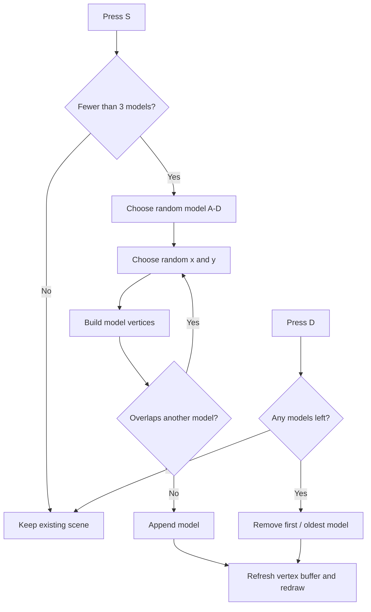

🟦 OpenGL Shape Playground
Interactive 2D Shape Generation & Management
A small C++ / OpenGL application that creates four square-based shapes, places them randomly without overlap, and lets you delete them in the order they were added.

The animated preview is taken from the actual running application. Click it to open the full demonstration.

✨ Highlights
Feature	How it works
🎲 Random shape generation	Every press of S selects one of four models.
📍 Random positioning	Shapes appear at randomly chosen grid coordinates.
🧩 No overlapping squares	New positions are tried until the model does not overlap an existing one.
🔢 Three-model limit	At most three models can be displayed simultaneously.
🗑️ First-in, first-out deletion	Pressing D removes the oldest model.
🔄 Immediate rendering	The displayed shapes update after every addition or deletion.

🎮 Controls
Key	Action
<kbd>S</kbd>	Add one randomly selected model (up to three at once).
<kbd>D</kbd>	Delete the oldest model currently on screen.
<kbd>Q</kbd>	Exit the application.

Tip: For S and D, release the key before pressing it again. Holding the key down does not repeatedly add or delete shapes.

🟨 The Four Models
Each model is built from 1 × 1 squares. Every square is drawn as two triangles.

🛠️ Tech Stack
- Language: C++
- Graphics: OpenGL 3.3 core profile
- Libraries: GLFW · GLEW · GLM
- IDE / platform: Microsoft Visual Studio · Windows · x64
- Rendering: Vertex buffers, GLSL shaders, and glDrawArrays(GL_TRIANGLES, ...)
🚀 Getting Started
[!IMPORTANT]
This repository contains the source code and GLSL shaders, not a ready-to-build Visual Studio solution or preconfigured library paths. You must set up the OpenGL dependencies in your own C++ project.

1. On Windows, create or open a C++ project in Microsoft Visual Studio, using the x64 platform.
2. Configure GLFW, GLEW, and GLM, along with the required OpenGL include directories and linker settings.
3. Add Source-1A.cpp to the project.
4. Make both shader files accessible from the application's working directory:
   - ProjectVertexShader.vertexshader
   - ProjectFragmentShader.fragmentshader
5. Build and run the application.
6. Press <kbd>S</kbd>, <kbd>D</kbd>, or <kbd>Q</kbd> to interact with the 900 × 900 window.

<b>🔤 Greek characters not showing correctly in the window title?</b>
If the Greek title displays as question marks, check that the C++ file is saved as UTF-8. In Visual Studio, you can also try:

Project → Properties → Configuration Properties → C/C++ → Command Line → Additional Options

Add /utf-8, then select Apply and Rebuild Solution. Also see the GLFW window title documentation.

🧠 How It Works
The application manages active models using vector<vector<GLfloat>> models and combines their vertices into a drawing buffer each frame.

<b>🔍 Main functions</b>
- addSquare() creates six triangle vertices for one square.
- createModel() constructs one of the four configurations.
- overlap() compares the occupied square positions of a new model with those of previously added models.
- models.push_back(newModel) adds a successfully placed model.
- models.erase(models.begin()) removes the oldest model.
- glBufferData() and glDrawArrays() update and render the visible geometry.

📁 Repository Structure
OpenGL-Shape-Playground/
├── README.md
├── Source-1A.cpp
├── ProjectVertexShader.vertexshader
├── ProjectFragmentShader.fragmentshader
├── .gitignore
└── demo/
    ├── demo.mp4         # Full recording (compressed for GitHub)
    └── preview.gif      # Animated README preview
🎥 Video Demonstration
The full demo shows the application running in Visual Studio and demonstrates how models are added and removed.

▶ [Play the complete demonstration](demo/demo.mp4)

If you want a GitHub-hosted video player directly in this README, use the GitHub README editor to attach demo/demo.mp4 and paste the generated video attachment URL on a line by itself in this section. The GIF above will still play automatically.
🎓 About This Project
Developed as a university computer graphics programming exercise. The original starter code and GLSL shader files were provided with the course materials; the square models and interactive management logic were implemented as part of the assignment.

  Built with C++ and OpenGL · From basic squares to an interactive shape playground

